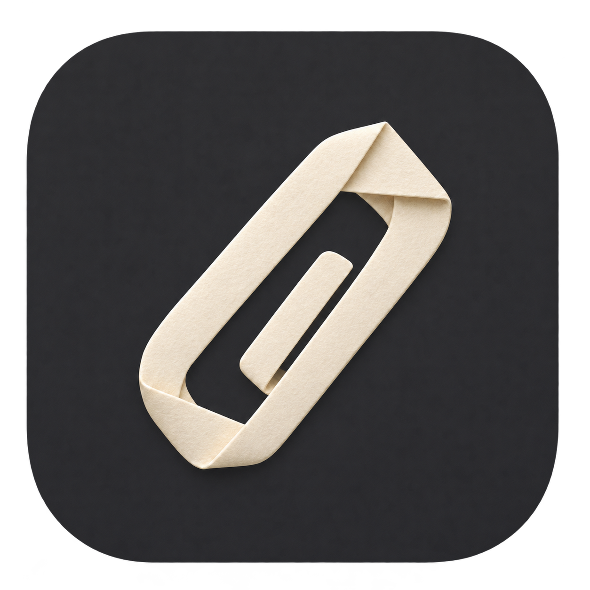

<p align="center">
  
</p>

<h1 align="center">Klip</h1>

<p align="center">
  Your clipboard, within reach.<br>
  A native macOS clipboard manager with searchable history and subtle notch previews.
</p>

<p align="center">
  <a href="#features">Features</a> ·
  <a href="#installation">Installation</a> ·
  <a href="#usage">Usage</a> ·
  <a href="#privacy">Privacy</a> ·
  <a href="#contributing">Contributing</a>
</p>

## Features

- **Find what you copied.** Search text, links, code, rich text, images, PDFs, files, and folders in one history.
- **Keep the original formats.** Copy items back with their available native clipboard representations, including grouped files.
- **A quiet confirmation.** Get a small animated copy indicator beneath the notch, or show a content preview automatically. Displays without a notch work too.
- **Preview before pasting.** See image thumbnails, PDF previews, and native macOS file icons. Double-click an entry for a closecr look.
- **Stay on the keyboard.** Open history with a global shortcut, navigate results, and copy an item without reaching for the mouse.
- **Pick up where you left off.** History is saved between launches by default, with up to 1,000 entries and configurable retention.
- **Make it yours.** Adjust sounds, volume, preview duration, appearance, and the global shortcut. Resize and move the history panel; Klip remembers it.
- **Control what gets captured.** Pause monitoring, exclude apps, hide previews, or turn off saved history.

Built with SwiftUI and AppKit. Requires **macOS 15.4 or later**.

## Installation

### Build from source

You’ll need **Xcode 27 or later**. Development has been verified with Xcode 27.1.

```sh
git clone https://github.com/zeeshan2k2/Klip.git
cd Klip
open Klip.xcodeproj
```

1. Select the **Klip** scheme and **My Mac** destination.
2. Select your development team under **Signing & Capabilities**, if prompted.
3. Press **⌘R** to build and run.

Launch at login requires an installed, signed build. Registration status appears in Settings.

## Usage

Copy something as usual, then press **⌘⇧V** or choose **Show Clipboard** from the menu bar. Search for an entry, select it, and press **Return** to copy it back. Paste into your destination app with **⌘V**.

| Action | Shortcut or control |
| --- | --- |
| Open clipboard history | ⌘⇧V, configurable in Settings |
| Move through results | ↑ / ↓ |
| Copy the selected item | Return |
| Copy one of the first nine results | ⌘1–9 |
| Inspect an item | Double-click its row |
| Share an item | Row’s share button |
| Delete an item | Right-click → Delete, or use the inspector |
| Close history | Escape or click outside |
| Open Settings | Gear button, or ⌘, while history has focus |

Content previews appear automatically after copying by default, without showing the copy indicator first. Turn off automatic previews in Settings to use the compact indicator instead; click it to preview your latest copy.

### Defaults

| Setting | Default |
| --- | --- |
| Save history between launches | On |
| History limit | 1,000 items |
| Retention | Until deleted |
| Copy feedback | Visual only |
| Automatic content previews | On |
| Content preview duration | 1 second; adjustable from 1–30 seconds |
| Copy icon duration | 1 second |
| Copy sound volume | 50% |
| Delete sound | On |
| Open Klip at login | On, subject to macOS approval |

## Privacy

Your history stays on your Mac. Klip saves captured clipboard data in a local archive; no account or cloud service is required.

- Pause monitoring at any time from the menu bar.
- Exclude apps from capture. Common password managers and Keychain Access are excluded by default, and recognized sensitive clipboard markers are respected.
- Turn off **Save history between launches** to remove the saved archive and keep history only until you quit.
- Use **Clear History** to remove current and saved entries.

Hiding previews conceals content in the interface; it does not stop capture or storage.

## FAQ

### Does selecting an item paste it automatically?

Selecting an item and pressing Return copies it back to your clipboard. Switch to the destination app and press **⌘V** to paste.

### Does Klip work without a notch?

Yes. Copy feedback appears at the top of the display.

### Are copied files backed up?

No. File entries keep references and bookmarks where available, rather than duplicating the files. Moving or deleting the originals can make them unavailable.

### Does every app-specific clipboard format work?

Klip preserves available native representations, but some app-specific or promised formats depend on the originating app. Incomplete captures are reported, and restoring a format depends on support in the destination app.

## Development

Klip uses native macOS frameworks and has no third-party package dependencies.

Run the existing checks from the repository root with Xcode selected as your active developer directory:

```sh
./scripts/check-phase2.sh
./scripts/check-phase3.sh
./scripts/check-phase4.sh
./scripts/check-expanded.sh
./scripts/check-interactions.sh
```

Run these sequentially. They cover clipboard round trips, privacy rules, persistence, keyboard interactions, preview timing, and audio behavior using private pasteboards, temporary archives, and isolated preferences. Some checks open temporary windows.

Physical notch animations, fullscreen Spaces, multiple displays, and sound levels should also be checked manually.

## Contributing

[Bug reports](https://github.com/zeeshan2k2/Klip/issues) and focused pull requests are welcome.

For bugs, include your macOS version, steps to reproduce, and what you expected to happen. Use sample clipboard content rather than personal data.

For changes, describe the resulting behavior and run the relevant checks. Include screenshots or a short recording for UI changes.

## License

A license has not yet been added to this repository.
